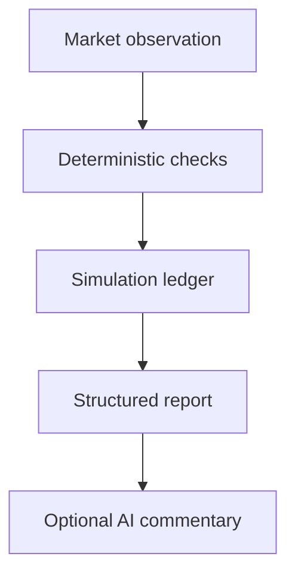

# Agent capabilities and evidence

GhOsT's goal is to make recorded market-evaluation decisions understandable and
auditable. This document describes an implemented constrained workflow, not
screening keywords or evidence of a deployed service.

## Architecture

- **Tools:** the feed adapter reads market discovery, books and settlements. It
  has no authenticated order-writing method. The operator exposes only
  `status`, `start`, `pause`, `tick`, and `run`.
- **State:** SQLite stores simulation balances, positions, orders, diagnostics,
  and the four-hour session deadline. An expiring durable lease prevents two
  workers from committing concurrently.
- **Decisions:** stale/missing data produces WAIT/BLOCKED outcomes. A recorded
  order is not treated as filled until a later qualifying book supports it.
- **Inference:** the optional client explains a bounded structured snapshot.
  Model output is inert commentary and never becomes an executable instruction.
- **Human control:** simulation starts explicitly and expires. No CLI command
  enables real orders, transfers funds, buys credits, or changes signer access.

## Observable evidence

| Claim | Code / verification |
| --- | --- |
| Paused on fresh install; no live actions | `tests/operator.test.mjs` |
| Persistent memory survives reopening | operator reopen test |
| Concurrent worker cannot write leased ledger | concurrency test |
| Stale data cannot place simulated orders | stale-book test |
| Same-window re-entry blocked after exit | take-profit test |
| AI cannot mutate persisted decisions | `tests/reporter.test.mjs` |
| No arbitrary titles, URLs or error strings sent to the model | observation allowlist test |
| Provider failures do not bypass deterministic checks | error/failure tests |
| Output labelled synthetic and offline | `examples/demo.mjs` |

These are implementation and software-test signals of agent work. They are not a
formal AI safety certification, a credit eligibility decision, or a profitability
evaluation. A language model can still produce misleading commentary; the
deterministic evidence remains authoritative.

## Current integration boundaries

The public Virtuals project identifies GhOsT and its Base token. This code has not
been installed on a persistent Virtuals host. It does not implement ACP job
acceptance/delivery/payment, an xAI Grok connection, or Base spot trading. The
included BTC outcome-contract experiment is isolated from the main GhOsT app.
